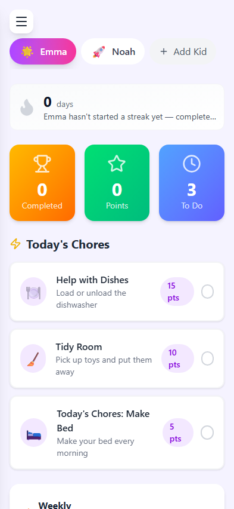

This repo is archived and no longer maintained.

# ChoreChamps

A gamified chore and habit tracker for kids: parents assign chores and rewards, kids earn points, streaks and badges.



## What it does

ChoreChamps turns household jobs into small, visible wins. Parents set up chores with point values, approve completions, and stock a rewards store. Kids see today's chores, tick them off, build streaks and spend their points on rewards the family agreed on. There are no ads and no third-party behavioural tracking.

This repository holds the v1 web app (Next.js, installable as a PWA and wrapped with Capacitor). A future native Apple client that works with [Family Planner](https://github.com/camster91/family-planner) is planned in [docs/CHORECHAMPS_2_NATIVE_APP_PLAN.md](docs/CHORECHAMPS_2_NATIVE_APP_PLAN.md).

## Features

**Parents**
- Create, assign and schedule chores for multiple children with custom point values
- Review and approve completions before points are awarded
- Define rewards with point costs and track redemptions
- Invite another parent to the family by link
- See completion history per child

**Kids**
- A colourful daily dashboard with today's chores, points and streak
- Badges for streaks and consistency, with celebration animations
- Habits alongside chores
- Spend points in the rewards store and an avatar shop

**Platform**
- Responsive layout for phone, tablet and desktop, installable PWA with an offline page
- Web push reminders
- Credentials sign-in with hashed passwords and rate limiting
- Capacitor projects for iOS and Android

## Tech stack

- Next.js 16 (App Router), React 19, TypeScript
- Tailwind CSS 4, Framer Motion, Lucide icons, Geist type
- Zustand and SWR for client state and data fetching, Zod for validation
- Prisma 7 with PostgreSQL
- NextAuth.js (credentials, JWT sessions), bcryptjs
- web-push, i18next
- Capacitor 8
- Node's test runner via tsx, Playwright for browser tests

## Getting started

Requires Node.js 20+ and PostgreSQL (or Docker).

```bash
git clone https://github.com/camster91/chore-champs.git
cd chore-champs
npm install
cp .env.example .env          # set DATABASE_URL, NEXTAUTH_SECRET and NEXTAUTH_URL=http://localhost:3000
docker-compose up -d postgres # optional: local Postgres with the defaults from .env.example
npm run db:push               # sync the schema to a clean local database
npm run seed                  # sample parent account, two children, chores and rewards
npm run dev                   # http://localhost:3000
```

Use a clean local database with `db:push` for development; committed migrations are for production deploys only.

## Testing

```bash
npm test           # unit tests for utilities, gamification rules and the PWA manifest
npm run test:e2e   # Playwright smoke tests (set E2E_AUTH=1 for the signed-in flow)
npm run lint
```

## Project structure

```
src/app/(auth)/        Sign-up and login
src/app/(dashboard)/   Dashboard, chores, habits, rewards, avatar shop, profile, settings
src/app/api/           API routes
src/actions/           Server actions (habits, avatar items and more)
src/lib/               Gamification rules, auth helpers, push notifications, i18n
prisma/                Schema and seed script
e2e/                   Playwright specs
android/, ios/         Capacitor projects
```

## License

[MIT](LICENSE)
